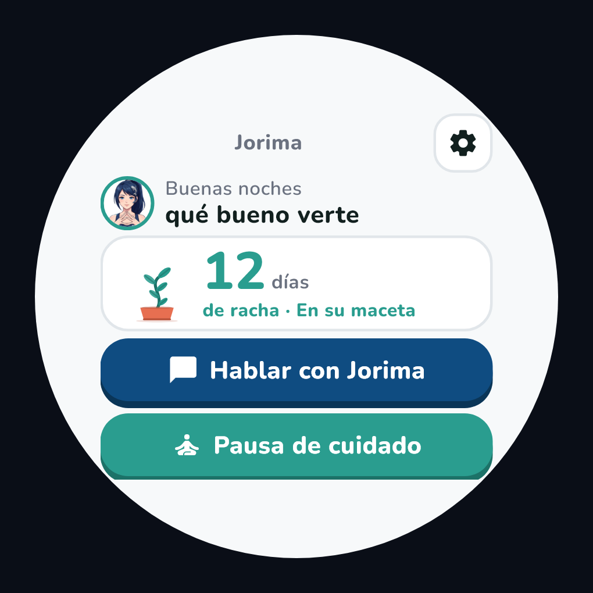
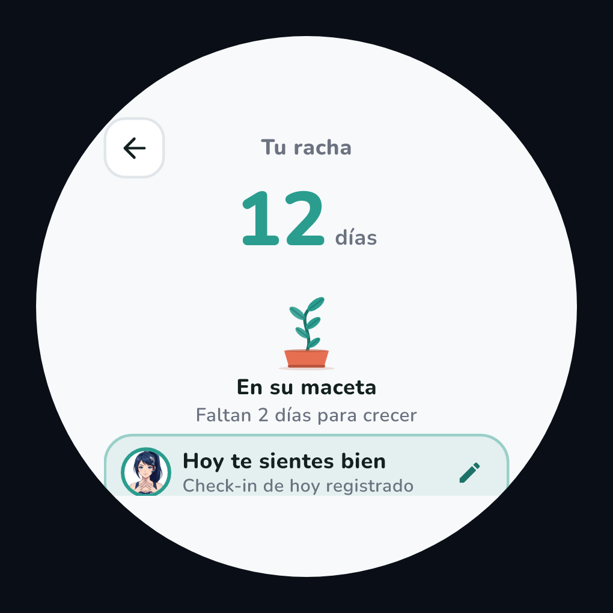
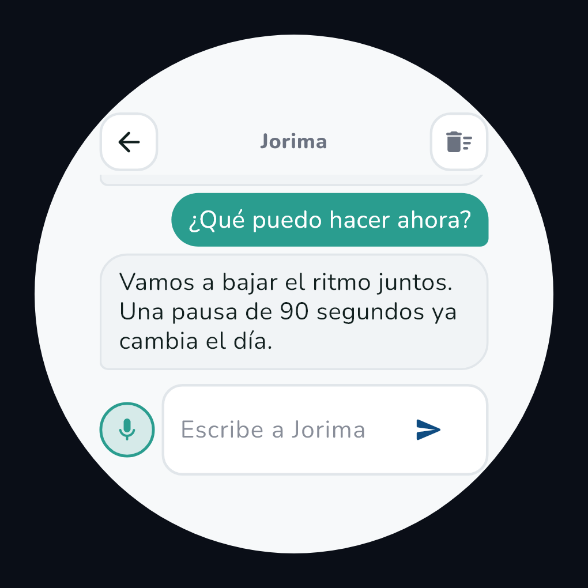
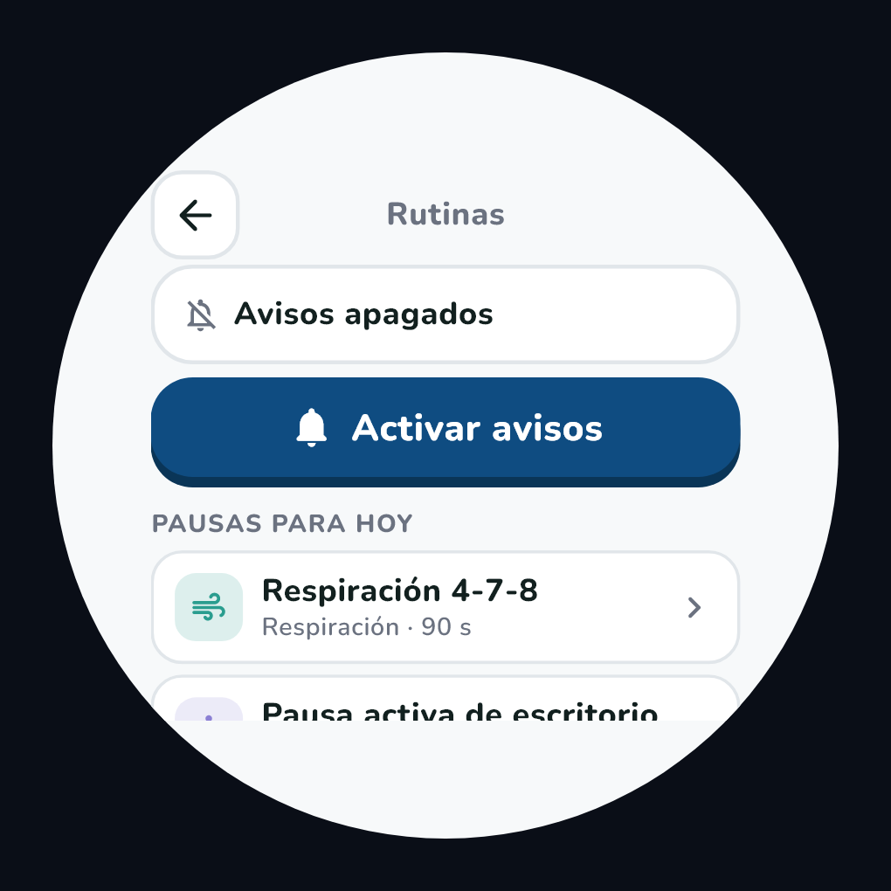
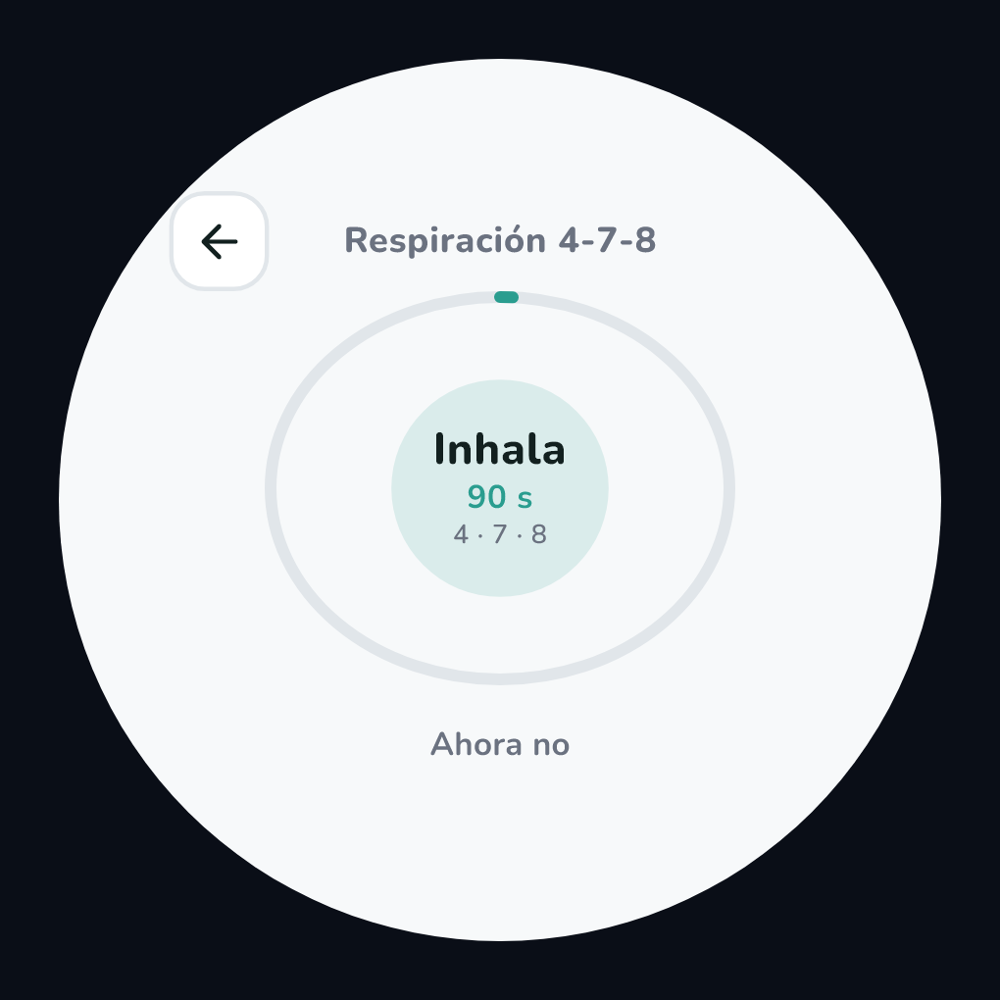
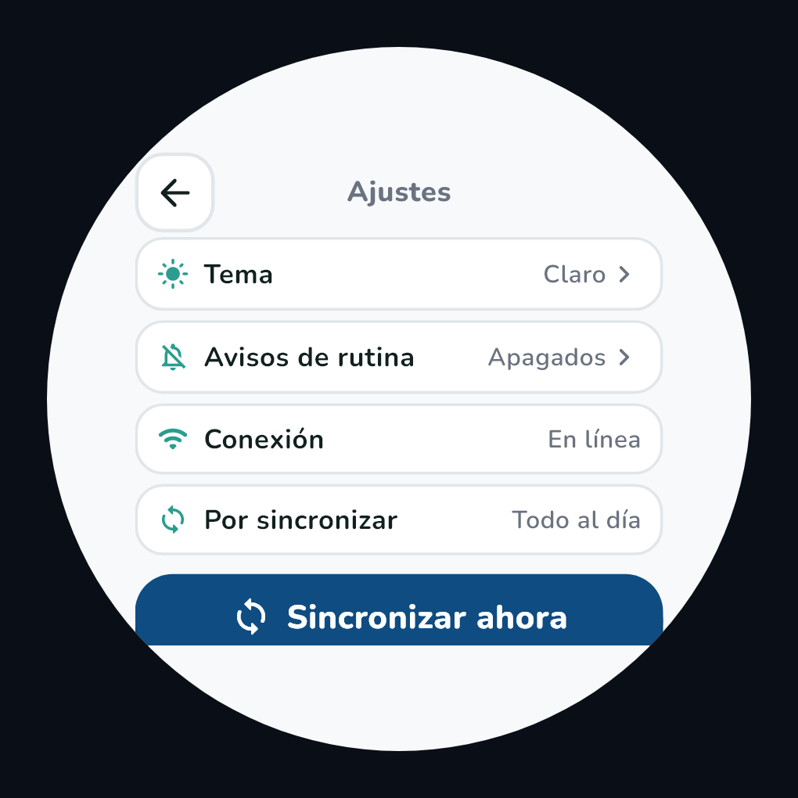

# Jorima Wearable — app para smartwatch en Flutter

Extensión de **Jorima** para reloj inteligente. Lleva a la muñeca los tres
requerimientos funcionales acordados y el widget del avatar del segundo parcial,
conectada a las **APIs reales** que ya usa la plataforma.

| ID | Requerimiento | Dónde está |
|---|---|---|
| RF-01 | Chat con el AI Assistant | `lib/ui/pantallas/pantalla_chat.dart` · `lib/state/chat_manager.dart` |
| RF-02 | Racha de cuidado con planta | `lib/ui/pantallas/pantalla_racha.dart` · `lib/ui/widgets/planta.dart` · `lib/state/streak_manager.dart` |
| RF-03 | Notificación de rutina de cuidado | `lib/services/notificaciones.dart` · `lib/state/routine_scheduler.dart` · `lib/ui/pantallas/pantalla_actividad.dart` |
| — | Widget del avatar | `android/app/src/main/kotlin/mx/utq/jorima_wearable/AvatarWidgetProvider.kt` |

---

## 1. Cómo se obtuvo la verdad sobre las APIs

El documento de contexto pedía **no inventar endpoints**. Por eso los contratos
no salieron de suposiciones: se leyeron del código del propio repositorio.

| Acción en el reloj | Endpoint real | Archivo del backend que lo define |
|---|---|---|
| Iniciar sesión | `POST /api/login/mobile` | `web/app/api/login/mobile/route.ts` |
| Leer la racha de hoy | `GET /api/animo/hoy` | `web/app/api/animo/hoy/route.ts` |
| Registrar el ánimo (mueve la racha) | `POST /api/animo` | `web/app/api/animo/route.ts` |
| Enviar mensaje al asistente | `POST /api/chat` | `web/app/api/chat/route.ts` |
| Historial de una conversación | `GET /api/chat?conversacion_id=` | `web/app/api/chat/route.ts` |
| Catálogo de rutinas | `GET /api/relajacion/catalogo` | `web/app/api/relajacion/catalogo/route.ts` |
| Registrar una pausa completada | `POST /api/relajacion/sesiones` | `web/app/api/relajacion/sesiones/route.ts` |
| Pausas acumuladas | `GET /api/relajacion/conteo` | `web/app/api/relajacion/conteo/route.ts` |

- **URL base:** `https://jorima-eight.vercel.app`, tomada de
  `movil/config/api.ts` (`VERCEL_URL`). No se inventó.
- **Autenticación:** `Authorization: Bearer <token>`, porque
  `web/middleware.ts` exige token para todo `/api/*` salvo las rutas públicas.
- **CORS:** `web/lib/cors.ts` deja pasar peticiones **sin** cabecera `Origin`,
  que es el caso de una app nativa. Por eso el reloj llega sin configuración
  extra.

### Una duda del documento que el código resolvió

El documento decía: *"Regla de la racha: se supone que sube al completar al
menos una rutina al día; falta confirmarla"*.

El backend lo resuelve: `web/lib/racha.ts` sólo escribe la racha desde
`app/api/animo/route.ts`, es decir, **la racha sube con el check-in de ánimo
diario, no al completar una rutina**. La app se implementó como está el
servidor: la pantalla de la racha incluye el check-in de ánimo, porque sin él la
planta nunca crecería.

Además, la racha del backend **no se reinicia a cero**: al faltar un día se
retoma desde `racha_raiz`, que sólo puede subir ("racha con raíz"). La planta
respeta esa regla: nunca se marchita, sólo crece más despacio
(`lib/state/crecimiento_planta.dart`).

---

## 2. Cómo ejecutarla

Requisitos (los del entorno donde se desarrolló, medidos y no supuestos):
Flutter **3.47.7**, Dart **3.13.5**, Android SDK con JDK 17.

```bash
cd wearable
flutter pub get

# En un emulador de Wear OS o en un reloj con depuración USB
flutter run

# Para instalar el APK
flutter build apk --release
```

El proyecto se creó sólo con plataforma Android (`--platforms=android`) porque el
destino es Wear OS.

### Verificación que sí se ejecutó

| Comprobación | Resultado real |
|---|---|
| `flutter analyze` | **No issues found!** |
| `flutter test` | **39 pruebas, todas en verde** |
| `flutter build apk --debug` | **app-debug.apk** construido |
| `flutter build apk --release` | **app-release.apk (53.1 MB)** construido |
| Layout a 220 × 220 px y a 300 × 300 px | sin desbordamientos |

La compilación del APK es lo que valida de verdad el lado nativo: el
`AndroidManifest` con sus permisos, el `AvatarWidgetProvider` en Kotlin, el
layout y los recursos del widget, el canal de notificación y la configuración de
Gradle (desugaring incluido).

---

## 2.1. Capturas reales

No hay emulador de Wear OS en este equipo, así que las capturas **no son
maquetas**: se generan renderizando el mismo árbol de widgets con el motor de
Flutter, a 300 × 300 px, con las fuentes Nunito y los avatares reales del
proyecto (`test/capturas_test.dart`).

```bash
CAPTURAS=1 flutter test test/capturas_test.dart
```

| Inicio | Racha | Chat |
|---|---|---|
|  |  |  |

| Rutinas | Actividad | Ajustes |
|---|---|---|
|  |  |  |

Están todas, en claro y en oscuro, en `docs/capturas/` (14 archivos).

**Ajuste a pantalla redonda.** El marco (`lib/ui/widgets/marco_reloj.dart`)
aplica 12.5 % de margen horizontal y 15 % vertical, y centra el contenido; con
eso el título y el botón de regreso quedan dentro del círculo en lugar de
quedar cortados por la curva del reloj. Las pantallas con mucho contenido se
desplazan, y los bloques que en un reloj pequeño no caben se encogen con
`FittedBox` en vez de desbordarse.

---

## 3. Estructura (la que pide la Práctica 2)

```
lib/
├── theme/          Tokens de globals.css: colores, Nunito, claro/oscuro
│   ├── colores.dart      #0F4C81, #2A9D8F, sombras, superficies, modo oscuro
│   ├── tipografia.dart   Nunito 400–800, cifras grandes, texto 12–15 px
│   └── tema.dart         radios 12/16/20, borde 2 px, sombra sólida de 4 px
├── ui/
│   ├── pantallas/  inicio, login, chat, racha, rutinas, actividad, ajustes
│   └── widgets/    botón chunky, burbuja de chat, planta, avatar, marco redondo
├── state/          ChatManager, StreakManager, RoutineScheduler, SesionManager,
│                   TemaController, Sincronizador, CrecimientoPlanta
├── data/
│   ├── api/        ApiCliente + un cliente por API (chat, racha, rutinas, auth)
│   └── local/      Almacén SQLite, almacén cifrado y cola de sincronización
└── services/       notificaciones, conectividad, almacenamiento seguro, dictado
```

La regla se respeta: **las vistas nunca llaman a la red directamente**. Siempre
pasan por un gestor de estado, que habla con un cliente de API.

---

## 4. Lo que hace cada requerimiento

### RF-01 · Chat con el AI Assistant

- Conversación real contra `POST /api/chat` (el backend usa el modelo de
  lenguaje; el reloj nunca simula respuestas).
- Mensajes breves: se recortan a 280 caracteres para que quepan en la pantalla.
- **Dictado por voz** con `speech_to_text` en español (`es_MX`), porque escribir
  en un reloj es incómodo. Si el reloj no tiene reconocedor, el botón del
  micrófono no se ofrece y la app sigue usable con teclado.
- Indicador de escritura de tres puntos, visible sólo mientras la petición está
  en vuelo (el backend no hace streaming).
- Respuestas rápidas para iniciar la conversación con un toque.
- Historial corto: **se guardan como máximo 20 mensajes**, cifrados.

### RF-02 · Racha de cuidado

- Número de días en grande y planta dibujada con `CustomPainter`.
- El tamaño es **proporcional** a `racha_actual` (sobre 30), con un piso
  permanente igual a `racha_raiz`: nunca desaparece.
- Etapas: Semilla → Brote → Planta joven → En su maceta → Arbolito →
  Floreciendo (a los 30 días aparece una flor).
- Check-in de ánimo con los cinco estados que acepta el backend
  (`muy mal`, `mal`, `regular`, `bien`, `muy bien`). Con datos reales, el avatar
  del personaje cambia de cara según el estado (usa las imágenes de
  `movil/assets/jorima/`).

### RF-03 · Rutina de cuidado

Traduce a Flutter los tres elementos que enseñó la Práctica 4 (TaskAlert):

| Elemento de la Práctica 4 | En Jorima Wearable |
|---|---|
| Notification Channel (API 26+) | Canal `rutinas_cuidado`, importancia **normal** |
| Permiso `POST_NOTIFICATIONS` (API 33+) | Se pide la **primera vez** que se activan las rutinas, explicando para qué |
| `PendingIntent` con `FLAG_IMMUTABLE` | `payload` + `onDidReceiveNotificationResponse` → abre **directo** la actividad |
| Botón GENERAR NOTIFICACIÓN | Botón "Probar un aviso" (sólo prueba) |

- Plan por defecto: **10:00 estiramiento · 14:00 respiración · 17:00 agua**,
  repetido a diario.
- Programación **inexacta** a propósito (`inexactAllowWhileIdle`): un recordatorio
  de bienestar no necesita precisión al segundo, y así no se pide el permiso de
  alarmas exactas, que es intrusivo.
- La actividad se guía: respiración 4-7-8 con círculo que se abre y se cierra,
  estiramiento por pasos con cuenta atrás, agua con confirmación.
- Al completarla se registra con `POST /api/relajacion/sesiones`.

### Widget del avatar

`AvatarWidgetProvider` (App Widget de Android) muestra el avatar sobre el azul
profundo de la marca y al tocarlo abre la app. Usa `PendingIntent` con
`FLAG_IMMUTABLE`, igual que la Práctica 4.

---

## 5. Seguridad y funcionamiento sin conexión

Lo que la Práctica 2 pide y cómo está resuelto:

| Requisito | Implementación |
|---|---|
| Token fuera de preferencias simples | `flutter_secure_storage` (Keystore de Android) |
| Conversaciones cifradas | AES-256-GCM, clave en el almacén seguro, **IV distinta por mensaje** (`lib/services/cifrado_local.dart`) |
| Se guardan pocas | máximo 20 mensajes en el reloj |
| Sin conexión: el chat no responde, el mensaje se encola | mensaje `pendiente` + cola; se reenvía al reconectar |
| Sin conexión: racha y rutinas siguen | caché local en SQLite, check-in optimista |
| Al reconectar, el servidor corrige diferencias | `Sincronizador` drena la cola al detectar red |

---

## 6. Diseño: el estilo de `globals.css`, en el reloj

Tokens copiados del CSS real, no aproximados:

| Token | Valor |
|---|---|
| Azul profundo / sombra | `#0F4C81` / `#0A3557` |
| Verde turquesa / sombra | `#2A9D8F` / `#1C7268` |
| Sol / sombra | `#F4A62A` / `#C4831F` |
| Lavanda / sombra | `#8B7FD4` / `#6B5FB0` |
| Coral / sombra | `#E76F51` / `#B8543C` |
| Fondo / superficie / borde | `#F7F9FA` / `#FFFFFF` / `#E1E6EA` |
| Modo oscuro | `#0B1120` / `#141B2D` / `#2B3548` |
| Radios / borde | 12 / 16 / 20 px · 2 px |
| Tipografía | Nunito 400–800 |

Y las reglas de la Práctica 1 para el reloj: **sin menú permanente** (inicio +
botón de regreso), **un dato o acción principal por pantalla**, botones que se
hunden 4 px con sombra sólida, texto de lectura entre 12 y 15 px y cifras mucho
más grandes, contenido dentro del cuadrado inscrito del círculo.

---

## 7. Pruebas

```bash
flutter test
```

39 pruebas, sin dispositivo:

- `test/crecimiento_planta_test.dart` — proporcionalidad del tamaño de la
  planta, piso de la raíz, etapas.
- `test/cifrado_test.dart` — ida y vuelta del cifrado, IV distinta por mensaje,
  que no quede texto plano en el almacén, recorte a 20 mensajes, cola.
- `test/gestores_test.dart` — chat en línea y sin red, reenvío al reconectar,
  racha en línea y sin red, agua que no se manda a la API, rutina encolada.
- `test/pantallas_test.dart` — las siete pantallas se montan a 220 × 220 px (el
  tamaño de un reloj redondo pequeño) sin desbordarse.

Los gestores se prueban con un backend simulado con `MockClient` del paquete
`http`: el cliente HTTP, la serialización, los errores y la cola son los reales;
sólo se simula la red.

La prueba de pantallas carga la Nunito real antes de medir. Es importante: sin
eso Flutter usa una tipografía de relleno con letras cuadradas y mucho más
anchas, y el reloj "parecería" desbordarse cuando con la fuente real todo cabe.

---

## 8. Decisiones y límites, dichos de frente

Nada de esto se rellenó con datos inventados:

1. **El agua no es un tipo de la API.** RF-03 pide "estiramientos, respiración,
   tomar agua", pero `TIPOS_VALIDOS` del backend sólo acepta `respiracion`,
   `estiramiento`, `juego`, `asmr` y `capsula`. El recordatorio de agua funciona
   como aviso **local** y no registra sesión, para no mandar un valor que el
   servidor rechazaría con un 400.
2. **No se probó en un reloj físico ni en un emulador de Wear OS.** Está
   verificado con `flutter analyze`, 39 pruebas (incluido el layout a tamaño de
   reloj), la compilación de los APK de debug y release, y capturas renderizadas
   del mismo árbol de widgets. Lo que falta es la prueba en el dispositivo: las
   capturas de `flutter doctor` y del emulador corriendo la app, que no se
   simulan.
3. **El certificado no está "pinned".** Se habla siempre por HTTPS, pero no se
   implementó *certificate pinning*: requiere el certificado del servidor y, sin
   poder probarlo en el dispositivo, no se deja código que parezca cumplirlo sin
   cumplirlo.
4. **Cifrado a nivel de campo, no de archivo.** El texto de los mensajes se cifra
   con AES-GCM y la clave está en el Keystore. Cifrar el archivo `.db` entero
   (SQLCipher) sería el siguiente paso si el proyecto lo pide.
5. **El widget es un App Widget clásico.** En Wear OS 3+ aparece en la pantalla
   de widgets del reloj. Un *Tile* de `androidx.wear.tiles` sería una versión más
   integrada a la esfera; el criterio acordado ("aparece en el reloj y abre la
   app") se cumple con lo implementado.
6. **La plataforma del reloj se resolvió por Flutter**, tal como pediste, con la
   observación que dejaba el documento sobre el soporte de plugins: los seis
   usados funcionan en Android/Wear OS. Falta la confirmación del profesor que el
   documento marcaba como decisión abierta.
